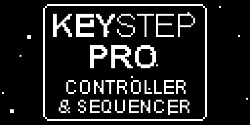

# keystep-doom

Runs DOOM on an Arturia KeyStep Pro as custom firmware, fully replacing the normal unit operation. It
plays a vanilla v1.9 demo of E1M1 in a loop on the 128x64 OLED at about 20 fps, in 480 KB of flash and
128 KB of RAM. The panel LEDs work as a HUD, and the game's sounds click through the metronome output.

[](https://youtu.be/ye-kf7i0vSI)

> **Use at your own risk.** This replaces your KeyStep Pro's firmware. It is not made, supported or
> endorsed by Arturia. Flashing it is entirely your own responsibility, and nobody but you is liable if
> anything goes wrong with your unit.

The whole 40-second demo, every frame as the OLED receives it:



The HUD:
- the 16 step LEDs show health, green, yellow or red
- the mod touch strip shows the ammo of the weapon in hand
- the pitch strip shows armour

## What runs

| | |
|---|---|
| engine | next-hack's MCU DOOM, from the IKEA-lamp port lineage, made vanilla-exact again, in `doom/` (GPLv2) |
| level | E1M1 from the Ultimate DOOM IWAD (v1.9) |
| input | none: it plays Donner's 1998 UV-Max demo of E1M1 (DSDA archive), 1137 tics, 29/29 kills, 3/3 secrets, then loops |
| demo sync | matches Chocolate Doom tic for tic: player state and RNG every tic |
| flash | 416,400 of 491,504 bytes (85%): code 182 KB, E1M1 data 235 KB |
| RAM | 109,948 of 131,072 bytes (84%), including a 6 KB stack and a 72 KB zone (peak use 24 KB) |
| display | 128x64, contrast-stretched each frame, Atkinson-dithered to 1 bit, about 20 fps (link-bound) |
| sound | DOOM's sound effects as clicks on the metronome output: shots, explosions, pain, deaths, doors and pickups, each with its own pitch and length |
| panel HUD | health on the 16 RGB step LEDs (green/yellow/red), ammo on the mod strip, armour on the pitch strip, driven through the UI firmware's own LED handlers |
| render time | 5.3 ms per frame average, 7 ms max, at 180 MHz |

Two MCUs are involved:

- **Main MCU (STM32F446-class).** It gets a new application image at `0x08008000`, and Arturia's 32 KB
  bootloader below it stays. `main/kd_board.c` takes over from the bootloader (USB off, interrupts
  cleared, flash wait states before clocks), then brings the chip up the way the stock firmware does,
  from a register trace of the stock boot: 180 MHz, the stock pin state, USART6 with DMA. Then it runs
  the engine and sends changed screen cells and LED states to the UI MCU.
- **UI MCU (STM32F091-class, owns the OLED).** It keeps its stock firmware plus a 120-byte patch
  (`ui/ui_patch.S`). The patch adds a raw-pixel packet type to the link and hands frames to the
  firmware's own OLED DMA.


## Cutting DOOM to fit

The IWAD is 14 MB and the engine stock needs megabytes of RAM. What fits in 480 KB of flash and 128 KB of
RAM (`doom/README.md` has the details):

- **Data:** only E1M1. `doom/converter/kd_convert.py` keeps just the textures, flats and sprites the
  level can show, composites multi-patch textures, and stores pixels as 4-bit luminance at half
  resolution with one light table. The level is baked into the engine's runtime structures, read in place
  from flash.
- **Engine:** no music, menus, status bar, automap, intermission, savegames, network or input. Sound
  effects become metronome clicks: the KeyStep's metronome is a timer square wave behind a gate, and
  each game sound opens the gate at its own pitch and for its own length.
- **Renderer:** DOOM's own renderer (BSP walk, wall columns, sprites, masked textures, weapon sprites)
  at 128x64. Floors and ceilings are filled per column instead of through visplanes, which saves the
  RAM, and the picture goes into an 8 KB luminance buffer before dithering. The game simulation is
  untouched, which is why the demo stays in sync tic for tic.
- **Memory:** game state and zone in one 128 KB region, with 16-bit pointers.

## Build it

You need:
- the stock `.kspf` from MIDI Control Center (for the UI MCU's firmware)
- your own Ultimate DOOM IWAD as `build/doomu.wad`
- the E1M1 demo as `build/e1m1.lmp` (`e1m1-032.zip` from dsdarchive.com)
- Python 3
- xPack arm-none-eabi-gcc

```bash
python tools/build.py ui
```

```bash
python doom/build.py data
```

```bash
python doom/build.py arm
```

```bash
python tools/build_image.py
```

- `tools/build.py ui` builds the UI patch (`patches/ui.json`).
- `doom/build.py data` and `arm` build `build/kd_wad_e1m1.bin` and `build/doom_arm/libkddoom.a`.
- `tools/build_image.py` links `build/keystep_doom.bin` and checks the budget.

## Flash it

> **At your own risk.** You are replacing the instrument's firmware. Back up your projects first (MIDI
> Control Center, Recall From). Arturia does not support this, and nobody but you is liable for your unit.

You need MIDI Control Center with the stock KeyStep Pro firmware 2.5.20 installed. After the build steps
above, make the update file from your own copy of the stock firmware:

```bash
python tools/make_kspf.py
```

It writes `build/keystep-pro_DOOM.kspf`:
- **Main MCU:** the DOOM image.
- **UI MCU:** Arturia's UI firmware plus the 120-byte frame patch.

The KeyStep Pro Chroma images are left out, so this file has nothing for a Chroma.

To install, power the KeyStep from its own adapter, connect USB without a hub, and in MIDI Control Center
choose the KeyStep Pro's firmware update and pick this file.

**Back to stock.** Turn the KeyStep off, patch a cable from **Clock In** to **Reset Out**, and turn it
on. The bootloader starts in update mode instead of DOOM (Arturia's documented recovery). Remove the
cable and update with the stock `.kspf` in MIDI Control Center.

## Licence and data

- The board code, UI patch and tools are MIT (`LICENSE`).
- `doom/` is GPLv2 (`doom/LICENSE`), so a linked firmware image is GPLv2 as a whole.
- No stock firmware, WAD data or demo files are in the repo. They are read from your own copies into
  `build/`, which is git-ignored.

## Credits

- The engine comes from next-hack's MCU DOOM ports (MG21DOOM, nRF52840 Doom), based on GBADoom, PrBoom
  and id Software's DOOM source.
- The E1M1 demo is by Yonatan Donner (1998, DSDA archive).

Looking for more cool stuff? I also release open source audio VST plugins as [WET VST](https://wetvst.com).
